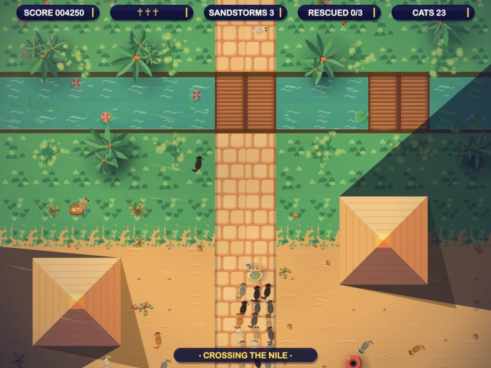
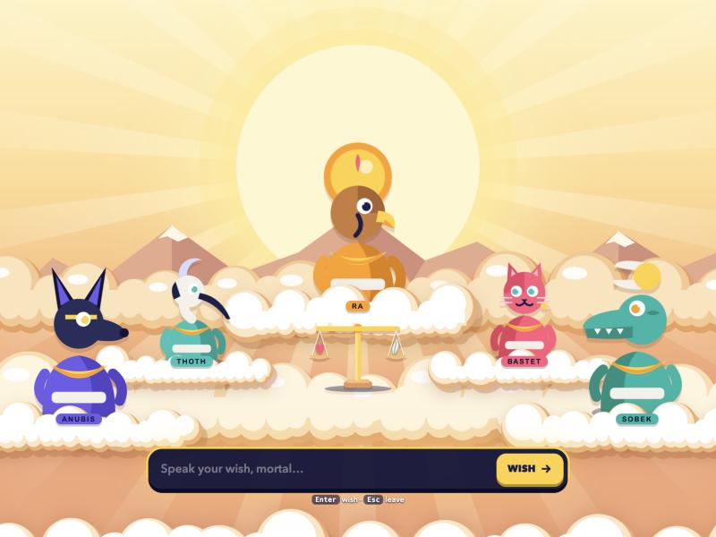

# Sands of Ra

My take on the game from **Davide Pasca's hands-on AI coding workshop** ([original project](https://github.com/dpasca/workshop_commando)).
The workshop gave everyone the same small shooter to start from and three exercises; everything here was built
on top of it during and after the workshop, with Claude Code, just for fun.



## What it is

A top-down shooter set in ancient Egypt. You play a pharaoh fighting your way up the Nile to the temple,
past mummies, sphinxes and the Pharaoh's chariot. You rescue captives, collect cats into an army that
fights for you, and throw sandstorms.

**The Council of the Gods:** press **E** and time stops. Five Egyptian gods appear in the sky and you can
type any wish. They grant most of them (and refuse about one in ten, with a joke). A granted wish plays out
in the game: lightning, stone tombs, portals to the underworld, mummies turned into cats, shields, a flight
to the temple, even redrawing part of the map. The gods' answers come from an AI (Claude), so every wish is different.



## What you need

- [Node.js](https://nodejs.org) (version 20 or newer)
- [pnpm](https://pnpm.io/installation)
- Optional, for the gods: the [Claude Code](https://claude.ai/code) app, installed and logged in.
  Without it the game works, but the gods stay silent.

## How to run it

```sh
pnpm install
pnpm dev
```

Then open http://localhost:5173 in your browser.

## Controls

| Key | Action |
|---|---|
| WASD | move |
| Mouse | aim |
| Click | shoot |
| Space or right-click | sandstorm |
| E | summon the gods |
| P or Esc | pause (resume, new game, settings) |
| R | new game |

## Credits

- The original game and workshop: Davide Pasca (MIT licence, see [LICENSE](LICENSE)).
- Workshop handouts: [workshop/](workshop/).
- A few sprites: [Kenney](https://kenney.nl) (CC0, see `public/assets/licenses/`).
